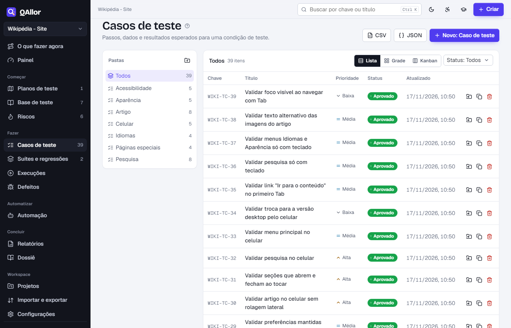

<div align="center">

# 🧪 QA · Wikipédia (site)

**Ciclo de teste completo da Wikipédia em português, do plano ao relatório de conclusão.**
Plano, casos, execução manual, defeitos e automação Playwright com CI, documentados no [QAllor](https://qallor.web.app).


[📄 Plano de teste](docs/plano-de-teste.pdf) · [✍️ Casos de teste](testes-funcionais/README.md) · [📊 Planilha de casos](docs/casos-de-teste.csv)

</div>

---

## 📌 Resumo

A [Wikipédia em português](https://pt.wikipedia.org) é um site real, em produção e editado por voluntários o tempo todo. O teste é feito só de leitura, sem editar nada.

O projeto segue as etapas de um ciclo de teste. Cada uma é entregue no seu dia:

| Dia | Etapa | Status |
|---|---|:-:|
| 16/11 | 🗺️ **Planejamento:** escopo, riscos, critérios de entrada e saída | ✅ |
| 17/11 | ✍️ **Análise e modelagem:** casos de teste por módulo | ✅ |
| 18/11 | ▶️ **Execução:** ciclo manual com evidências e registro de defeitos | ⏳ |
| 19/11 | 🤖 **Automação, parte 1:** Playwright, page objects e fluxos principais | ⏳ |
| 20/11 | 🔁 **Automação, parte 2 e conclusão:** CI, relatório de conclusão e resumo de qualidade | ⏳ |

## 🗺️ Planejamento

**Objetivos:** verificar os requisitos observados, encontrar defeitos, dar confiança para a regressão e reduzir os riscos mapeados.

### Escopo

| Dentro | Fora |
|---|---|
| Pesquisa (exata, sugestões, sem acento, sem resultado) | Edição e publicação de artigos |
| Leitura de artigo (título, índice, cabeçalho fixo, links, referências) | Login e cadastro |
| Troca de idioma | Outras wikis (Commons, Wikcionário) |
| Artigo aleatório, histórico e artigo inexistente | API (projeto separado, semana de 23/11) |
| Menu Aparência (texto, largura e cor) | Carga e desempenho |
| Versão para celular (pt.m.wikipedia.org) | Auditoria completa de WCAG |
| Acessibilidade básica (teclado, texto alternativo, console) | |

### Base de teste

Não existe especificação pública. A base é o comportamento observado no site em 16/11/2026, escrito como 7 histórias com critérios de aceite:

| ID | Requisito | Prioridade |
|---|---|:-:|
| WIKI-RQ-1 | Pesquisa de artigos | Crítica |
| WIKI-RQ-2 | Leitura do artigo | Crítica |
| WIKI-RQ-3 | Outros idiomas | Alta |
| WIKI-RQ-4 | Páginas especiais | Média |
| WIKI-RQ-5 | Aparência da leitura | Média |
| WIKI-RQ-6 | Leitura no celular | Alta |
| WIKI-RQ-7 | Acessibilidade básica | Média |

### Riscos

| ID | Risco | Prob. | Impacto | Nível | Resposta |
|---|---|:-:|:-:|:-:|---|
| WIKI-RK-1 | Pesquisa não levar ao artigo certo | 2 | 5 | 10 | Pesquisa exata, sugestão, sem acento e sem resultado, todos no smoke |
| WIKI-RK-2 | Conteúdo dos artigos muda a qualquer momento | 5 | 2 | 10 | Testes conferem estrutura, não o texto |
| WIKI-RK-3 | Mudança do tema Vector 2022 quebrar localizadores | 3 | 3 | 9 | `getByRole` e textos visíveis; ids só quando estáveis |
| WIKI-RK-4 | Layout do celular esconder pesquisa ou conteúdo | 2 | 4 | 8 | Projeto Playwright com Pixel 7 |
| WIKI-RK-5 | Teclado ou leitor de tela não conseguir usar os menus | 2 | 4 | 8 | Casos só com teclado e checagem de texto alternativo |
| WIKI-RK-6 | Site público limitar os testes automáticos | 2 | 3 | 6 | Poucos workers, retries só no CI, trace na primeira falha |

### Critérios

| Entrada | Saída |
|---|---|
| Site no ar | 100% do smoke passando |
| Plano revisado | Todos os casos executados ao menos uma vez |
| Casos revisados antes da execução | Defeitos registrados com passos, esperado, obtido e evidência |
| | Taxa de aprovação de pelo menos 90% |

**Abordagem:** testes de sistema e aceite, funcionais e não funcionais, caixa-preta. Técnicas: partição de equivalência, transição de estados (menu Aparência), suposição de erro, checklist e exploratório.
**Ambientes:** produção, Chromium desktop 1280x720 e Pixel 7.
**Estimativa (três pontos):** otimista 6h, provável 9h, pessimista 14h → **9,3h**.

### O que mudou desde a versão de junho

Este projeto refaz um plano que escrevi em junho de 2026. Ao revisar o site, encontrei duas mudanças:

- A página de artigo inexistente não mostra mais o texto "A Wikipédia não possui um artigo com este nome exato.". Ela responde 404 e oferece pesquisar o termo nos projetos irmãos. O critério foi reescrito.
- Apareceu o menu **Aparência** (tamanho do texto, largura e tema escuro em beta). Ele entrou no escopo como WIKI-RQ-5.

Também entraram no escopo a versão para celular e a acessibilidade básica, que o plano antigo não cobria.

## ✍️ Análise e modelagem

**39 casos de teste, 57 passos, em 7 módulos.** Cada caso tem objetivo, pré-condições, passos com dados e resultado esperado, e está ligado a um requisito. Antes de escrever o resultado esperado, conferi no site cada comportamento (por exemplo: o texto "Grande" passa a fonte de 16 px para 20 px e a escolha continua depois de recarregar a página).

| Módulo | Casos | Requisito |
|---|:-:|---|
| [Pesquisa](testes-funcionais/01-pesquisa.md) | 8 | WIKI-RQ-1 |
| [Artigo](testes-funcionais/02-artigo.md) | 8 | WIKI-RQ-2 |
| [Idiomas](testes-funcionais/03-idiomas.md) | 4 | WIKI-RQ-3 |
| [Páginas especiais](testes-funcionais/04-paginas-especiais.md) | 4 | WIKI-RQ-4 |
| [Aparência](testes-funcionais/05-aparencia.md) | 5 | WIKI-RQ-5 |
| [Celular](testes-funcionais/06-celular.md) | 5 | WIKI-RQ-6 |
| [Acessibilidade](testes-funcionais/07-acessibilidade.md) | 5 | WIKI-RQ-7 |

**Técnicas:** checklist (18 casos), partição de equivalência (13), transição de estados (5, nas preferências de Aparência e nas seções do celular) e suposição de erro (3: pesquisa vazia, pesquisa com HTML e erros de JavaScript).
**Prioridade:** 2 críticas, 10 altas, 19 médias e 8 baixas.

**Suítes:**
- **Smoke (6 casos):** página principal, pesquisa exata, sugestões, título do artigo, troca para inglês e artigo no celular. Responde se dá para usar o site.
- **Regressão (39 casos):** todos os casos.

Cada risco do plano tem casos ligados a ele no QAllor, menos o WIKI-RK-6 (limite do site público), que é tratado na configuração da automação.

<p align="center"></p>

## 🗂️ Estrutura

```text
qa-wikipedia/
├── docs/
│   ├── plano-de-teste.pdf      📄 plano gerado no QAllor
│   ├── casos-de-teste.csv      📊 os 39 casos em planilha (UTF-8, separador ;)
│   ├── prints/                 🖼️ telas do projeto no QAllor
│   └── qalor/wiki.qalor.json   fonte do plano, requisitos, riscos, casos e suítes (importável no QAllor)
├── testes-funcionais/          ✍️ os 39 casos por módulo, com passos e resultado esperado
└── scripts/gerar-docs.mjs      gera testes-funcionais/ e as planilhas a partir do QAllor
```

As próximas etapas acrescentam `docs/defeitos/` e `automacao/`.
